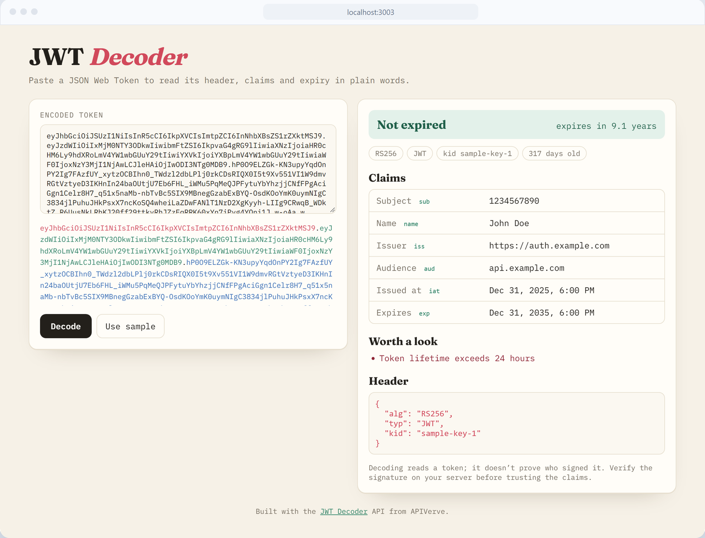

# JWT Decoder | APIVerve Template

[](LICENSE)
[](package.json)
[](tsconfig.json)
[](https://apiverve.com/marketplace/jwtdecoder?utm_source=github&utm_medium=template&utm_campaign=jwt-decoder-nextjs-tutorial)

A JWT decoder you can deploy in one click. Paste a JSON Web Token and read its header and claims in plain words: who issued it, who it's for, when it was issued and when it expires, with each part of the token colour-coded.

[](https://vercel.com/new/clone?repository-url=https%3A%2F%2Fgithub.com%2Fapiverve%2Fjwt-decoder-nextjs-tutorial&project-name=jwt-decoder&repository-name=jwt-decoder&env=APIVERVE_API_KEY&envDescription=Your%20APIVerve%20API%20key.%20Free%20to%20create%2C%20no%20card%20needed.&envLink=https%3A%2F%2Fdashboard.apiverve.com%2Fsignup%3Fapi%3Djwtdecoder%26utm_source%3Dvercel%26utm_medium%3Dtemplate%26utm_campaign%3Djwt-decoder-nextjs-tutorial)



---

### Get your free API key

This template needs an APIVerve API key. **[Sign up free](https://dashboard.apiverve.com/signup?api=jwtdecoder&utm_source=github&utm_medium=template&utm_campaign=jwt-decoder-nextjs-tutorial)**, no credit card required.

---

## Deploy in one click

Click **Deploy with Vercel** above. Vercel copies this repo to your GitHub account, asks for your `APIVERVE_API_KEY`, and gives you a live URL about a minute later.

## Run it locally

```bash
git clone https://github.com/apiverve/jwt-decoder-nextjs-tutorial.git
cd jwt-decoder-nextjs-tutorial
npm install
cp .env.example .env   # then set APIVERVE_API_KEY in .env
npm run dev
```

Open `http://localhost:3000`. To see it in a phone and a browser frame side by side, open `http://localhost:3000/showcase.html`.

## How it works

1. `components/JwtApp.tsx` is the page. It posts the pasted token to `/api/decode`, and decodes a sample token on first load.
2. `app/api/decode/route.ts` checks the input, then calls JWT Decoder. Your API key stays on the server and never reaches the browser. Answers are cached for 10 minutes under a SHA-256 hash of the token, never the token itself, and cached answers don't count against the rate limit.
3. The page names each registered claim (iss, sub, aud, exp and so on), turns timestamps into dates, and shows whether the token has expired.

Everything on the page works on a free key: header, claims, algorithm and expiry. Paid plans add the token's age and a short security review, such as flagging very long-lived tokens, which the page shows when present.

```
app/
  api/decode/route.ts   validates the token shape, then calls JWT Decoder
  layout.tsx
  page.tsx
  globals.css
components/
  JwtApp.tsx            the page
  sample.ts             a sample token for first load
lib/
  apiverve.ts           key, rate limit and cache helpers
public/
  showcase.html         phone and desktop demo frame
```

### The API call

```ts
const res = await fetch('https://api.apiverve.com/v1/jwtdecoder', {
  method: 'POST',
  headers: { 'x-api-key': process.env.APIVERVE_API_KEY!, 'Content-Type': 'application/json' },
  body: JSON.stringify({ token })
});
const { data } = await res.json(); // data.header, data.payload, data.isExpired
```

## Before you share your URL

Once deployed, anyone who finds your URL can use it on your API key. Each visitor can make 10 uncached requests a minute, and repeat lookups come from the cache, which is fine for a demo. Both are kept in memory, so they aren't shared between serverless instances. For production:

- Put the page behind your own sign-in, or
- Move the limit and cache to a shared store such as [Upstash Redis](https://upstash.com/), or
- Call the route only from your own backend.

Decoding is not verifying. A decoded token tells you what it claims, not who signed it, so verify the signature on your own server before trusting it.

## Ideas to extend it

- Add an HMAC signature playground with [HMAC Generator](https://apiverve.com/marketplace/hmac).
- Decode Base64 segments by hand with [Base64 Encoder/Decoder](https://apiverve.com/marketplace/base64).
- Convert any timestamp claim with [Unix Timestamp Converter](https://apiverve.com/marketplace/unixtimestamp).

## API reference

- [JWT Decoder](https://apiverve.com/marketplace/jwtdecoder?utm_source=github&utm_medium=template&utm_campaign=jwt-decoder-nextjs-tutorial): `POST https://api.apiverve.com/v1/jwtdecoder`
- [Full documentation](https://docs.apiverve.com?utm_source=github&utm_medium=template&utm_campaign=jwt-decoder-nextjs-tutorial)

## Tech stack

- **Next.js 16** (App Router) and **React 19**, in **TypeScript**
- A **Route Handler** in `app/api/` for the server side, so the key never reaches the browser
- Deploys to Vercel as-is, with no configuration

## License

MIT. See [LICENSE](LICENSE).
